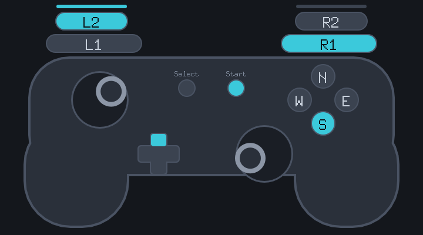

# ntgamepad — Game controllers for Go, native and in the browser, without cgo

<p>
    <a href="https://nimbleterminal.github.io/ntgamepad/"></a>
    <a href="https://github.com/NimbleTerminal/ntgamepad/tags"></a>
    <a href="https://pkg.go.dev/nimbleterminal.dev/ntgamepad"></a>
    <a href="https://github.com/NimbleTerminal/ntgamepad/actions/workflows/ci.yml"></a>
    <a href="./LICENSE"></a>
    <a href="./CODE_OF_CONDUCT.md"></a>
</p>

`ntgamepad` (`nimbleterminal.dev/ntgamepad`) polls game controllers from Go
programs: in a terminal, in a native window, or in the browser as
WebAssembly. It builds with `CGO_ENABLED=0` on every platform and reports
every controller in one layout.

On macOS it carries its own drivers for the **Nintendo Switch 2 Pro
Controller**, which the system does not recognise, and the **Sony
DualSense**, which the system shows only to programs with a main run loop.

**[Try the live browser demo →](https://nimbleterminal.github.io/ntgamepad/)** Connect a controller and press a button on it.

<p>
  <a href="https://nimbleterminal.github.io/ntgamepad/"></a>
</p>

## Quickstart

```sh
go get nimbleterminal.dev/ntgamepad@latest
```

Requires Go 1.26.8 or later.

```go
pad := ntgamepad.Open()
defer pad.Close()

var prev ntgamepad.State
for frame() {
	s := pad.Poll().WithDeadzone(0) // 0 means the default deadzone
	if s.JustPressed(prev)&ntgamepad.ButtonSouth != 0 {
		jump()
	}
	steer(s.LeftX)
	prev = s
}
```

## What's inside

- **One layout.** Every platform reports the W3C Standard Gamepad: two
  sticks (`+X` right, `+Y` up), two triggers in `[0, 1]`, and sixteen
  buttons as a bit set.
- **Polling, not events.** Call `Poll` (the first controller) or `PollAll`
  (all of them, up to `MaxPads`) once a frame. Neither blocks. A controller
  plugged in or removed shows up in the next poll; `State.Index` is a slot
  it keeps while connected.
- **Button edges.** `JustPressed(prev)` and `JustReleased(prev)` compare two
  polls, so a game does not track the previous button mask itself.
- **No cgo.** Builds with `CGO_ENABLED=0` everywhere. Only the macOS build
  links an FFI library ([goffi](https://github.com/go-webgpu/goffi)); the
  others use the standard library alone.

## Platforms

| Platform | Reads | State |
| --- | --- | --- |
| Browser (`js/wasm`) | `navigator.getGamepads()` | Demo page runs in Chrome and Firefox; both list the Switch 2 Pro Controller, Safari does not |
| macOS | GameController.framework, pumped from polls on the main goroutine; built-in HID drivers for the Switch 2 Pro Controller (USB) and the DualSense | Probe observations for the Switch 2 and DualSense appear below |
| Linux | `/dev/input/js0`–`js3` | Compiles; event decoding tested without a device |
| Windows, others | nothing | Reports no controllers |

Each row records what someone observed with `cmd/ntgamepad-probe` on the listed hardware.

| Platform | Controller | Result |
| --- | --- | --- |
| macOS 27.2, USB | Nintendo Switch 2 Pro Controller | Works with the built-in driver: sticks and buttons read correctly in the probe. Unplugging and replugging while a program runs is not yet tried. |
| macOS 27.2, Bluetooth | Sony DualSense | Through the framework from a terminal program: listed, left stick and Cross read live. Through the HID driver: found and read at rest in the pad's enhanced mode. Other Bluetooth controls remain unverified. |
| macOS 27.2, USB | Sony DualSense | One pad stayed in slot 0 as polling switched from HID off the main goroutine to GameController.framework on it. The left stick responded on both paths. Cross also registered on the framework path. |

### Browser

A browser shows a page no controllers until the user presses a button on one.
Controllers the browser reports with `mapping: "standard"` are used. Others
have no known layout and are skipped, except those this package knows by
name. A recognized controller keeps its assigned slot until it disconnects,
including when its browser index is greater than or equal to `MaxPads`.
Both demos show the assigned slot beside the browser entry.

The Switch 2 Pro Controller is one of those, in Chromium browsers and
Firefox on macOS. Both listed it over USB. Stick directions still need a
hands-on check in each browser. Two limits apply:

- A page cannot start the pad. Something native must have sent the start-up
  sequence since the pad was plugged in: run `cmd/ntgamepad-probe`, or any
  program that uses this package, once.
- A page cannot read the pad's calibration, so the sticks use a nominal one
  and may rest a few percent off centre, inside the default deadzone.

Safari does not show the pad to a page at all: it takes its controllers from
macOS, which does not recognise this one.

The [demo](#demo) page shows what the package reads beside what the browser
itself reports.

### macOS

Needs macOS 11 or later. No entitlement, `Info.plist`, app bundle or helper
program is needed.

Controllers reach a program two ways, and the reader uses both:

- **GameController.framework**, for every pad Apple supports. The framework
  hands a program its controllers through the main run loop, which a Go
  program does not have. So the package keeps the main goroutine on the main
  thread and, when a poll is made from it, lets the main run loop handle what
  is waiting first. Measured with a DualSense on macOS 27.2: a Go terminal
  program polling from its main goroutine is shown the pad within 50 ms and
  reads its sticks and buttons; one that never runs the loop is shown none.
- **Built-in HID drivers**, for a pad Apple does not support (the Switch 2
  Pro Controller) and for a program that polls from another goroutine, where
  the framework shows nothing (the DualSense, so far).

What this asks of a program:

- **Poll from the main goroutine** to get every pad the system supports. A
  Bubble Tea program does already: `Update` runs on the goroutine that called
  `Run`. Polling from another goroutine still works, for the pads with a
  driver of their own.
- **The main goroutine stays on the main thread.** Importing the package
  pins it there (`runtime.LockOSThread` in `init`), as libraries that need
  the main thread do.
- A poll from the main goroutine also runs whatever else is waiting on the
  main run loop, without waiting for more. A callback can call `Notes()` or
  poll another reader. A nested poll reads the current controller state
  without running the loop again.

The reader switches on `GCController.shouldMonitorBackgroundEvents` (macOS
11.3), so input arrives while the program is not the frontmost app. Set
`NTGAMEPAD_HID=off` to leave the HID drivers out and see what the framework
reports alone.

### DualSense (macOS, Bluetooth and USB)

Polls on the main goroutine normally read the framework's input. The built-in
HID driver also discovers each DualSense by its I/O Registry entry. When one
framework controller and one HID device can be paired, either can supply input
in the same player slot. If several identical pads appear together, the reader
keeps the assignments it already has. A pad visible only in the other list may
have to wait until the pairings are clear. The one-pad handoff was verified over USB on macOS 27.2.
The two-pad case has synthetic test coverage.

- The pad reports in one of two forms, depending on what else on the machine
  has spoken to it; the driver reads both and uses whichever arrived last.
- Cross is `ButtonSouth` and Circle is `ButtonEast`. The triggers are
  analogue, and count as pressed past half travel.
- The PlayStation button, the touchpad and the motion sensors are not
  reported.

### Switch 2 Pro Controller (macOS, USB)

macOS does not recognise this controller, and the controller sends nothing
until it is told to. `ntgamepad` carries its own driver for it: a background
goroutine finds the pad, reads its stick calibration, and sends the start-up
sequence over the pad's vendor USB interface; polls then read the pad's HID
values. Nothing needs installing, and no permission is asked for.

- USB only. Bluetooth is not supported.
- B is `ButtonSouth` and A is `ButtonEast`: buttons are reported by position,
  not by the letter printed on them. ZL and ZR are switches, so the triggers
  read 0 or 1.
- Home, Capture, C and the rear paddles are not reported: the standard layout
  has no place for them.
- A pad plugged in while the program runs appears within about a second.
- Another program holding the pad's vendor interface (a second driver) keeps
  this one from starting it.

See [Acknowledgements](#acknowledgements) for where the protocol comes from.

### Linux

Uses the kernel's joystick interface with the numbering of the `xpad` driver
(Xbox controllers and those that present as one). Controllers handled by
other drivers number their buttons and axes differently and will read wrong.
The user needs read access to `/dev/input/js*`.

## When a controller does not show up

`ntgamepad.Notes()` reports anything that limits which controllers the
program is shown, on the platform it is running on and given how it is
polling. It is empty when there is nothing to say. Each note has a stable
`Code` to act on and an English `Text` to read.

```go
for _, n := range ntgamepad.Notes() {
	log.Println("ntgamepad:", n.Text)
	if n.Code == ntgamepad.NoteNeedsButtonPress {
		showHint() // in the game's own words, and the player's language
	}
}
```

The text is for the developer, in a debug view or a log, and is not
translated. A game that wants to tell its players something goes by the code
and writes its own message. What the notes cover:

| Code | Platform | When |
| --- | --- | --- |
| `NotePollOffMainGoroutine` | macOS | polls come from a goroutine other than the main one, so only the pads with a built-in driver are visible |
| `NoteFrameworkUnavailable` | macOS | the macOS controller framework could not be initialized and the reader reports no controllers |
| `NoteDriversOff` | macOS | the built-in drivers are switched off (`NTGAMEPAD_HID=off`) |
| `NoteNeedsButtonPress` | Browser | no controller is listed yet: the browser waits for a button press |
| `NoteGamepadAccessDenied` | Browser | the page’s permissions policy blocks gamepad access. Polling resumes when access returns |
| `NoteControllerSkipped` | Browser | the browser lists a controller the package skipped |
| `NotePermissionDenied` | Linux | the latest poll was denied permission to open a joystick device |
| `NoteUnsupportedPlatform` | Elsewhere | the platform has no controller support |

The probe and the controller viewer both print these notes.

## Checking a controller

```sh
go run ./cmd/ntgamepad-probe            # prints a line whenever anything changes
go run ./cmd/ntgamepad-probe -for 10s   # stops by itself
```

Press each button and move each stick, and check the line that prints.

## Demo

The controller viewer (`examples/pad`) is one Bubble Tea program with two
renditions of the controller, switched with `g`:

- **Picture:** the controller drawn in pixels and shown through
  [ntpicture](https://github.com/NimbleTerminal/ntpicture): sticks that move,
  buttons that light.
- **Cells:** the same in terminal cells, for any terminal.

```sh
task pad                # in this terminal
task web:serve          # in a browser, at http://127.0.0.1:8017/
```

It is also published at <https://nimbleterminal.github.io/ntgamepad/>.

In the browser the same program runs as WebAssembly inside a terminal, through
[booba](https://github.com/NimbleTerminal/booba). There it also lists what the
browser itself reports, so a controller the package skips can be told from
one the browser cannot see. A plain HTML version of the page, without a
terminal, is at `plain.html`.

The viewer lives in its own module, `examples/`, so that Bubble Tea, booba and
ntpicture are not dependencies of the library.

## Testing code that uses it

`Reader` is an interface. Give your code a `Reader` of your own that returns
the states you want; do not call `Open` in tests. `example_test.go` has one.

## Open Collaboration

Run `task ci` before submitting changes. It checks Go formatting and module
tidiness, vets for six targets (macOS, Linux and Windows natively, and
`js/wasm`), and runs the tests of the library and the examples. It requires
Go 1.26.8+ and [Task](https://taskfile.dev), and runs the browser reader in
Node when Node is installed. [AGENTS.md](./AGENTS.md) states the repository's
rules, and [docs/SOURCES.md](./docs/SOURCES.md) where each protocol and
capture comes from. On pushes and pull requests, Ubuntu CI runs
`task fuzz-smoke` against the Linux joystick decoder, browser mappings,
Switch 2 and DualSense reports, and USB descriptors. Open work is in
[ROADMAP.md](./ROADMAP.md).

```sh
task ci                 # the full gate
task fuzz-smoke         # every fuzz target, 5s each (override with FUZZTIME=30s)
task test:wasm          # the browser reader, as WebAssembly, in Node
task probe              # print what the attached controllers report
task pad                # the controller viewer, in this terminal
task web:serve          # build and serve the browser demos
```

Contributions and feedback are welcome. Please adhere to our
[Code of Conduct](./CODE_OF_CONDUCT.md).

- [Report an issue](https://github.com/NimbleTerminal/ntgamepad/issues)
- [Submit a pull request](https://github.com/NimbleTerminal/ntgamepad/pulls)

## Acknowledgements

`ntgamepad` began as a package of [nt3d](https://github.com/NimbleTerminal/nt3d).

The Switch 2 Pro Controller's start-up sequence and report layout are those
worked out by the [SDL](https://github.com/libsdl-org/SDL) project
(`SDL_hidapi_switch2.c`, contributed by Valve under the zlib license); the
driver here is an independent implementation of that protocol.

The macOS build calls system frameworks through
[goffi](https://github.com/go-webgpu/goffi).

## License

Released under the [MIT License](./LICENSE).

Copyright (c) 2026 [Neomantra Corp](https://www.neomantra.com).

----
Made with :heart: and :fire: by the team behind [Nimble Terminal](https://nimbleterminal.dev).
